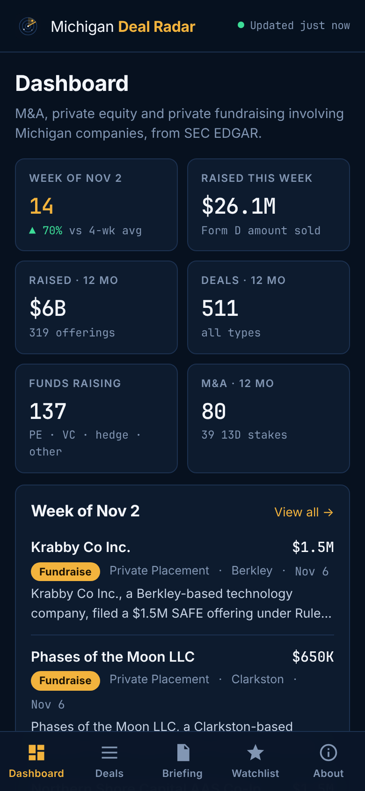
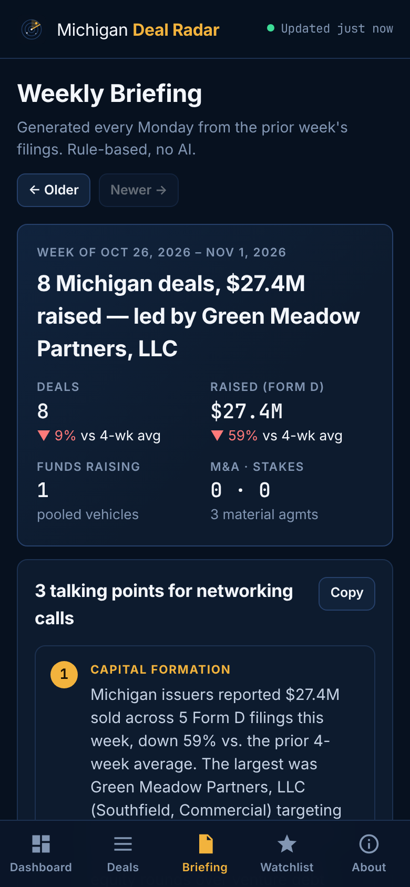
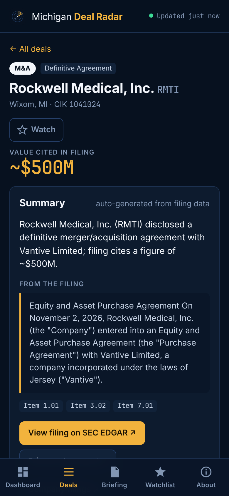
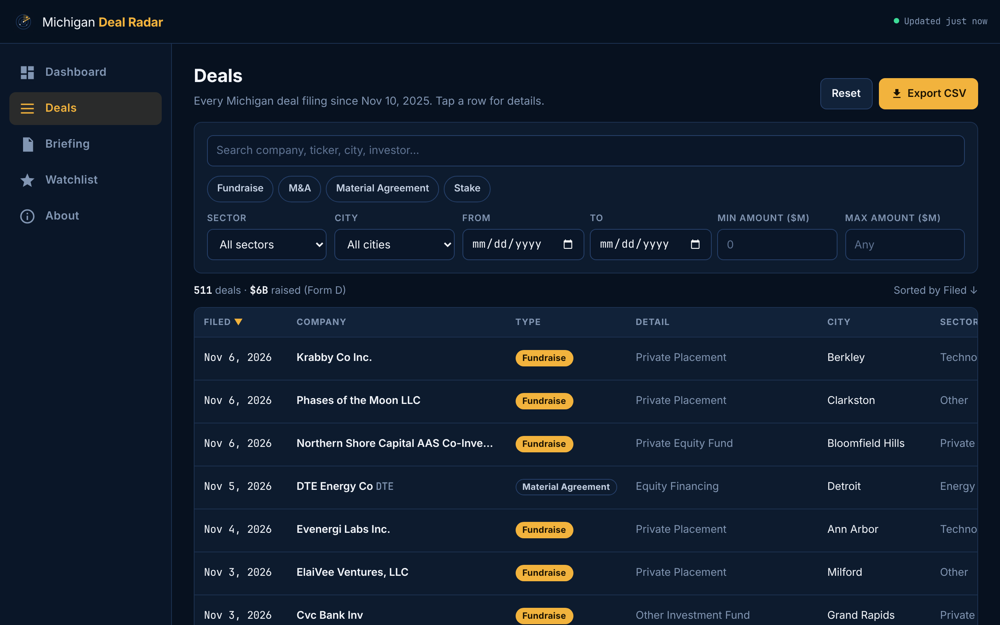
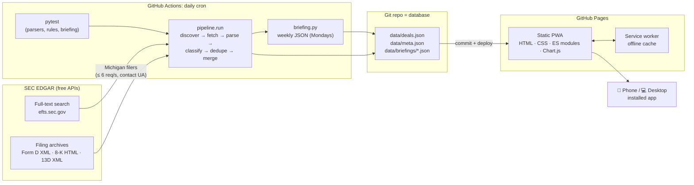

# Michigan Deal Radar

**A free, installable web app that tracks M&A, private equity, and private fundraising activity involving Michigan companies, rebuilt every day from SEC EDGAR filings, with a rule-based weekly deal briefing.**

[**Live app →**](https://jacksonrbond.github.io/michigan-deal-radar/) · [Methodology](https://jacksonrbond.github.io/michigan-deal-radar/#/about) ·  

<p align="center">
  
  
  
</p>

<p align="center"></p>

## What it does

| | |
|---|---|
| **Dashboard** | This week's deals, KPIs (capital raised, fund raises, M&A), capital raised by month, deals by type and sector |
| **Deal table** | Search plus filters for type, sector, city, date range and amount. Sortable columns, shareable filter URLs, **CSV export** |
| **Deal detail** | Offering terms, investors, related persons, amendment history, filing excerpt, and links to the original SEC filing |
| **Weekly briefing** | Generated every Monday: top deals by size, new fund raises, notable M&A, and **3 talking points for networking calls**, with a full archive |
| **Watchlist** | Star companies to follow them. Stored privately on-device (localStorage), with "new since last visit" highlighting |
| **Installable PWA** | Home-screen icon, splash screen, standalone window, and offline access to the last loaded data |

**Hard constraints:** $0 to run forever, entirely in the cloud (GitHub Actions + GitHub Pages), and **no AI/LLM calls at runtime**. Every classification, summary and talking point comes from deterministic Python rules and templates.

## Architecture



### Pipeline (Python, `pipeline/`)

| Module | Responsibility |
|---|---|
| `sec_client.py` | Polite HTTP client: contact User-Agent, global throttle (6 req/s, under SEC's 10/s limit), retry with backoff on 429/5xx |
| `edgar.py` | Full-text search paging (`locationCodes=MI`), month windows, accession de-duplication, filing-index lookup |
| `formd.py` | Form D XML parser: issuer, city, industry group, offering/sold/remaining, first-sale date, pooled-fund type, exemptions, related persons |
| `eightk.py` | 8-K section splitter (Items 1.01 / 2.01 / 8.01), M&A vs. financing rules, deal-value and counterparty extraction, excerpt |
| `schedule13d.py` | Structured Schedule 13D/13D-A parser: subject company, reporting persons, % of class |
| `deals.py` / `sectors.py` | Normalize everything into one deal schema, map Form D industries and SIC codes to one sector taxonomy, templated summaries |
| `store.py` | Upsert/merge (Form D amendments collapse into one offering with history), atomic JSON writes |
| `briefing.py` | Weekly briefing: stats vs. trailing 4-week average, top deals, funds, M&A, sector mix, 3 prioritized talking points |
| `collectors.py` / `run.py` | Orchestration and CLI. **Each filing is processed in its own try/except**, so one bad filing is logged to `meta.json` and skipped, never crashing the run |

### Classification rules (no AI)

| Type | Rule |
|---|---|
| **Fundraise** | Form D with a Michigan principal place of business. Subtype = *Private Placement* or the fund type (PE / VC / hedge / other) |
| **M&A** | 8-K Item 2.01; Item 1.01 whose opening describes a merger/purchase agreement; 8.01/7.01 with strong merger language; or Form D flagged as a business combination |
| **Material Agreement** | Other 8-K Item 1.01, sub-typed by keyword (credit facility, debt offering, equity financing, employment, lease, commercial) |
| **Stake** | Schedule 13D / 13D-A where the **subject company** is headquartered in Michigan |

Noise filters: asset-backed securitization trusts (SIC 6189) are excluded, and earnings 8-Ks that only mention a merger in an exhibit are skipped. A credit agreement whose text references the merger it finances is classed as a *Material Agreement*, not M&A.

### Data schema (`data/deals.json`)

```jsonc
{
  "id": "D-2163797-021-603899",        // Form D: CIK + SEC file number (amendments merge); 8-K/13D: accession
  "type": "Fundraise",                  // Fundraise | M&A | Material Agreement | Stake
  "subtype": "Private Placement",
  "form": "D", "accession": "0002163797-26-000001",
  "company": "Krabby Co Inc.", "cik": "2163797", "ticker": null,
  "city": "Berkley", "state": "MI",
  "industry": "Other Technology", "sector": "Technology",
  "filed": "2026-11-06", "event_date": "2026-10-26",
  "amount": 1500000, "amount_sold": 166500, "amount_is_estimate": false,
  "summary": "Krabby Co Inc., a Berkley-based technology company, filed a $1.5M SAFE offering under Rule 506(b); $166.5K sold to 1 investor.",
  "excerpt": null, "counterparty": null, "items": [],
  "related_persons": [{ "name": "Fletcher Liverance", "roles": ["Executive Officer", "Director"] }],
  "details": { "investor_count": 1, "exemptions": ["Rule 506(b)"], "is_pooled_fund": false, "...": "..." },
  "url": "https://www.sec.gov/Archives/edgar/data/2163797/000216379726000001/0002163797-26-000001-index.htm",
  "filings": [{ "accession": "…", "filed": "2026-11-06", "form": "D", "amount_sold": 166500 }]
}
```

## Data sources

- **SEC EDGAR full-text search** (`efts.sec.gov/LATEST/search-index`), filtered to filers whose business address is in Michigan, for forms `D`, `8-K`, and `SCHEDULE 13D`.
- **EDGAR filing archives** (`sec.gov/Archives/edgar/data/...`): the primary document of each filing (Form D `primary_doc.xml`, 8-K HTML, 13D XML).
- All requests follow the [SEC fair-access policy](https://www.sec.gov/os/accessing-edgar-data): a descriptive User-Agent with a contact email, and a hard throttle of 6 requests/second.

## Running it locally

```bash
git clone https://github.com/jacksonrbond/michigan-deal-radar.git
cd michigan-deal-radar
python -m venv .venv && source .venv/bin/activate
pip install -r requirements.txt

pytest -q                                  # unit tests for parsers, rules, briefings
python -m pipeline.run                     # incremental update (last 10 days)
python -m pipeline.run --backfill 365      # rebuild 12 months of history (~2-3 min)
python scripts/serve.py                    # open http://localhost:8000
```

Set `SEC_USER_AGENT="YourApp/1.0 (you@example.com)"` to use your own contact email. Shortcuts live in the `Makefile` (`make test`, `make backfill`, `make serve`).

## Deployment (free)

| Workflow | Trigger | What it does |
|---|---|---|
| `update-data.yml` | Daily cron (11:17 UTC) + manual | Tests → pipeline → commit `data/` → deploy |
| `deploy.yml` | Push to `main` (app/data) + called by the above | Assembles `_site/` (app + data, cache-busted service worker) → GitHub Pages |
| `ci.yml` | Push / PR touching the pipeline | `pytest` |

Briefings: the daily job writes a briefing for every completed Mon–Sun week that doesn't have one yet, so Monday's run publishes the prior week's briefing.

## Install the app

- **iPhone / iPad:** open the live URL in **Safari** → Share → **Add to Home Screen**.
- **Android:** open in **Chrome** → ⋮ menu → **Install app** (or tap **Install app** in the header).
- **Desktop (Chrome / Edge):** click the install icon in the address bar, or **Install app** in the header.

After the first load, the app shell and last-loaded data work offline (a banner shows how old the saved data is).

## Project structure

```
pipeline/            Python data pipeline (no third-party deps beyond requests)
tests/               pytest suite + real SEC filing fixtures
data/                deals.json, meta.json, briefings/ (committed by the bot)
app/                 static PWA: index.html, css/, js/ (ES modules), sw.js, manifest, icons/
scripts/             serve.py (local dev), build_site.sh (Pages bundle)
.github/workflows/   update-data, deploy, ci
```

## Limitations

- Form D amounts are self-reported and filed within 15 days of first sale; many private deals never file one.
- The 8-K "value cited" is the largest dollar figure in the deal section, a parsed estimate shown with `~`.
- Location is the filer's EDGAR business address, so Michigan operating companies headquartered elsewhere are missed.
- Not investment advice; always confirm against the linked filing.

## License

MIT. Data is public SEC EDGAR information.
