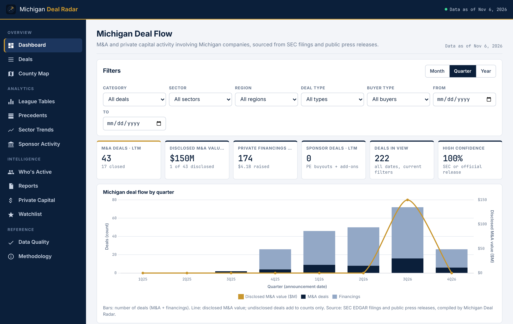
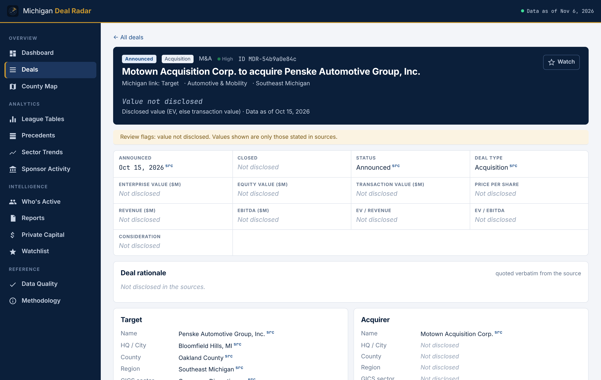
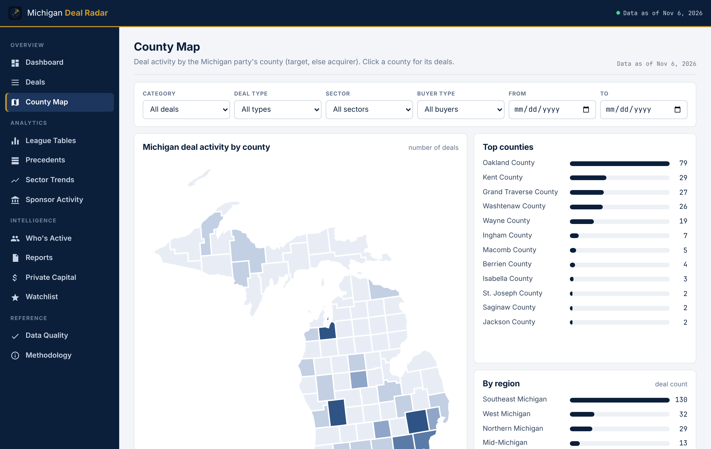
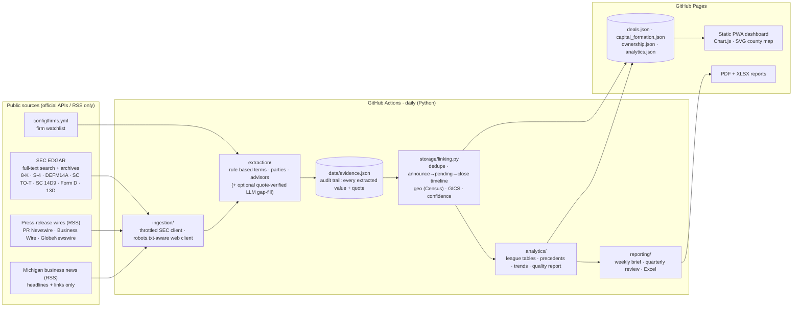

# Michigan Deal Radar

**M&A and private-capital intelligence for the Michigan middle market.** Every deal is built from SEC EDGAR filings and public press releases, every field carries its source URL and the exact source text, and the whole platform runs for $0 on GitHub Actions and GitHub Pages.

[**Live app →**](https://vibecoderjb.github.io/michigan-deal-radar/) · [Methodology](https://vibecoderjb.github.io/michigan-deal-radar/#/about) · [Data quality](https://vibecoderjb.github.io/michigan-deal-radar/#/quality) · [Weekly brief (PDF)](https://vibecoderjb.github.io/michigan-deal-radar/#/briefing)

 

<p align="center"></p>

## What it does

| Area | Capability |
|---|---|
| **Deal flow dashboard** | Deal count and disclosed value by month / quarter / year; filters for sector, region, deal type, buyer type and date. |
| **Deal tear sheets** | Parties (with county, region, GICS), terms, financials, advisors, rationale, timeline, and a **`src`** footnote on every value showing the verbatim source text. |
| **County map** | Michigan choropleth of deal activity, by county and region (Census boundaries). |
| **League tables** | Most active acquirers, PE sponsors, financial advisors, legal advisors and lenders. |
| **Precedent transactions** | Disclosed values and multiples with median / mean / range; exportable to a banking-format Excel workbook. |
| **Sector trends** | Quarter-over-quarter and year-over-year counts across automotive & mobility, advanced manufacturing, healthcare, software, consumer and business services (and more). |
| **Sponsor activity** | PE platform buyouts vs. add-ons by quarter. |
| **Who's Active in Michigan** | Banks, PE firms and law firms that appear most often on Michigan deals, with recent deals and publicly named deal teams. |
| **Reports** | Weekly *Michigan Deal Flow* PDF brief, quarterly *Michigan M&A Review* PDF, and an Excel workbook (cover tab, frozen headers, $M with one decimal, 8.5x multiples, source links). |
| **Private capital** | Michigan fund vehicles raising capital (Form D) and 13D stakes, kept out of M&A counts. |
| **Data quality** | After every run: new deals, duplicate filings merged, missing fields, low-confidence records flagged for review. |
| **Installable app** | PWA (phone, desktop, offline) plus Electron desktop builds. |

<p align="center">
  
  
</p>

## Key findings

<!-- KEY-FINDINGS:START -->
_Generated from the dataset after each pipeline run._
<!-- KEY-FINDINGS:END -->

## Architecture



**Design choices worth noting**

- **Evidence first, deals derived.** Each filing becomes an *evidence event* (what was fetched, what was extracted, and the exact sentence each value came from). Deals are rebuilt from evidence on every run, so a rule fix re-derives the full history consistently. Filing text is archived (gzipped) so rules can be re-run offline: `python -m pipeline.run --reextract`.
- **Field-level provenance.** Every field is `{value, source_url, source_text, method}`, where `method` is `filing_metadata`, `rule`, `derived` or `llm_verified`. Missing values are `null` and render as *Not disclosed*; computed values carry `estimate: true` and render as **EST.**
- **Git as the database.** At this scale, versioned JSON is free, diffable and auditable. Every data change is a commit.

## Methodology

**Sources and collection rules.** Official APIs and public RSS only. SEC fair access: declared User-Agent with a name and email (stored as a GitHub secret), throttled to 6 requests/second. robots.txt is checked before every non-SEC request; paywalled outlets contribute headlines and links only. Google News RSS is deliberately excluded because its robots.txt disallows automated access.

**Extraction.** Rule-based first: values are only taken from sentences that say what they are ("enterprise value of", "per share in cash", "EBITDA of"); parties are resolved from the filing's defined terms (e.g. `Merger Sub` merges into `"Noble"`, which resolves to *Noble Africa LLC*). An optional LLM (GitHub Models, free in Actions) fills only unresolved buyer/target roles, and its answer is **discarded unless its quote appears verbatim in the source** and contains the extracted name.

**Deduplication.** SEC filings about one transaction (signing 8-K, merger proxy, tender filings, closing 8-K) are clustered by the merger agreement's signing date, then by counterparty, then by closing-follows-announcement. Filings by both parties (two Michigan public companies) merge into one deal; news items join an SEC deal when a party matches within 120 days.

**Confidence.** High = SEC filing or official press release · Medium = reputable news · Low = single unconfirmed report. A deal takes its best source's level.

**Classification.** Deal types: Acquisition, Merger, PE Buyout, Add-on, Growth Equity, Venture Round, Recapitalization, Divestiture / Carve-out, IPO, Debt Raise. Status: Rumored, Announced, Pending, Closed, Terminated. Sector: SEC SIC / Form D industry group → approximate GICS sector and sub-industry → Michigan focus sector. Geography: city or ZIP → county (point-in-polygon on Census boundaries) → region.

**Known limitations.** Most private middle-market deals never touch EDGAR and many releases omit terms, so value and multiple coverage is sparse by nature. RSS only carries recent items, so the 24-month history is SEC-based and news coverage grows from launch. Location is the EDGAR business address. Rule-based role detection can miss unusual structures; those deals are flagged for review instead of guessed.

## Tech stack

| Layer | Tools |
|---|---|
| Pipeline | Python 3.12 · `requests` · `PyYAML` · standard-library XML/RSS parsing |
| Reports | Jinja2 HTML templates → headless Chrome PDF · `openpyxl` (Excel) · dependency-free SVG charts |
| App | Vanilla ES modules (no build step) · Chart.js 4 · SVG county map · service worker (offline) |
| Reference data | U.S. Census county boundaries (`us-atlas`) · GeoNames places · ZIP centroids, built by `scripts/geo/build_geo.mjs` |
| Quality | pytest with real SEC filings as fixtures · Playwright browser smoke tests · per-run data-quality report |
| Infra ($0) | GitHub Actions (daily pipeline, CI, deploy) · GitHub Pages · GitHub Models (optional) · Electron (desktop builds) |

## Project structure

```
pipeline/
  ingestion/     sec_client.py (throttle/retry), edgar.py (full-text search), web.py (robots.txt-aware RSS client)
  extraction/    terms.py (deal terms, parties, advisors), eightk.py, formd.py, schedule13d.py, entities.py, llm.py
  sources/       sec.py (filings -> evidence events), news.py (wire/news RSS -> evidence)
  storage/       store.py, linking.py (dedupe -> deals), news_linking.py, migrate_v1.py
  reference/     geo.py + mi_geo.json (counties/regions), gics.py (SIC/Form D -> GICS)
  analytics/     metrics.py (league tables, precedents, trends), quality.py
  reporting/     briefing.py, pdf.py + templates/, excel.py, build.py, readme.py
  run.py         CLI orchestrator
app/             static PWA (index.html, css/, js/, js/views/, sw.js, assets/mi-counties.json)
config/          firms.yml (watchlist), sources.yml (RSS feeds)
data/            deals.json, capital_formation.json, ownership.json, analytics.json, evidence.json,
                 briefings/, quality/, evidence_text/ (gzipped filing text), backup/ (v1 archive)
tests/           pytest suite + fixtures (real 8-K, Form D, 13D filings); e2e/ browser smoke test
desktop/         Electron wrapper + installer workflow
```

## Setup

```bash
git clone https://github.com/VibecoderJB/michigan-deal-radar.git
cd michigan-deal-radar
python -m venv .venv && source .venv/bin/activate
pip install -r requirements.txt
export SEC_USER_AGENT="MichiganDealRadar/2.0 (Your Name; you@example.com)"   # required by SEC fair-access rules
```

```bash
pytest -q                                      # unit tests
python -m pipeline.run                         # incremental update (last 10 days)
python -m pipeline.run --backfill 730          # rebuild 24 months of history
python -m pipeline.run --reextract             # re-run extraction rules on archived filing text (offline)
python -m pipeline.reporting.build --out _site/reports   # PDFs + Excel
python scripts/serve.py                        # app at http://localhost:8000
```

**GitHub (free):** add the repository secret `SEC_USER_AGENT` (Settings → Secrets and variables → Actions), set Pages → Source to *GitHub Actions*, and allow *Read and write* workflow permissions. The `Update data` workflow then runs daily; run it once manually with `backfill_days = 730` to load 24 months.

| Workflow | Trigger | What it does |
|---|---|---|
| `update-data.yml` | Daily cron + manual | Tests → pipeline (SEC + RSS) → quality report → commit data → deploy |
| `deploy.yml` | Push to `main` / called by the above | Assembles the site, renders PDF + Excel reports, publishes to Pages |
| `ci.yml` | Push / PR | pytest; builds a v2 dataset offline and runs the browser smoke test |
| `desktop.yml` | Manual / `v*` tag | Windows / macOS / Linux desktop installers |

## Install the app

- **Windows / Mac:** open the live site in Edge or Chrome and use the install icon in the address bar (Edge: ⋯ → Apps → *Install this site as an app*). This route isn't blocked by Windows Smart App Control.
- **iPhone:** Safari → Share → *Add to Home Screen*. **Android:** Chrome → ⋮ → *Install app*.

## License

MIT. Data is public SEC EDGAR information and publicly published press releases; not investment advice.
